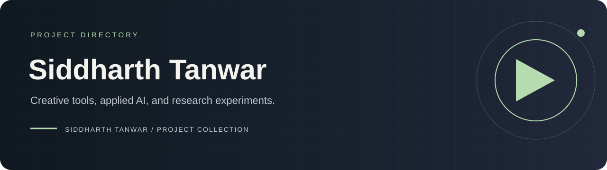

# Siddharth Tanwar · Project directory

A navigable index of my public project collection: creative production tools, applied AI systems, machine-learning studies and data engineering.

[Portfolio](https://siddharthtanwar1.github.io) · [GitHub](https://github.com/SiddharthTanwar1)

## Creative studios

| Project | Explore |
|---|---|
| [Cartoon Studio](https://github.com/SiddharthTanwar1/cartoon-studio) | Script-directed cartoon scenes, local voices, reusable rigs and explanatory visuals |
| [Stickman Studio](https://github.com/SiddharthTanwar1/stickman-studio) | Narration-led illustrated stories, editable storyboards and local video production |

## Applied AI and engineering

| Project | Explore |
|---|---|
| [Agent Permit](https://github.com/SiddharthTanwar1/agent-permit) | Deterministic tool authorization and explicit policy boundaries |
| [Document Delta & Grounded Chat](https://github.com/SiddharthTanwar1/delta-chat) | Document revision comparison, change reports and citation-grounded retrieval |
| [Vibe Matcher](https://github.com/SiddharthTanwar1/Nexora-) | Fashion retrieval with fast, richer-scoring and hybrid strategies |
| [Sloooze](https://github.com/SiddharthTanwar1/sloooze) | Crawling, ETL, data-quality checks and exploratory analysis |

## Research notebooks

| Project | Explore |
|---|---|
| [SimSiam study](https://github.com/SiddharthTanwar1/DL-Project-SimSiam-reimplementation-) | CIFAR-10 representation learning, ablations and evaluation |
| [Momenta](https://github.com/SiddharthTanwar1/Momenta) | Real-versus-synthetic speech experiments |

Each repository documents its own setup, scope, evidence and limitations. Experimental notebooks should be read with their reproduction notes; saved metrics are not promises of production performance.

This `siddharth` repository is a project directory. It is not the special account-profile README repository, which would need to match the account username exactly. [Original placeholder](README-ORIGINAL.md).
